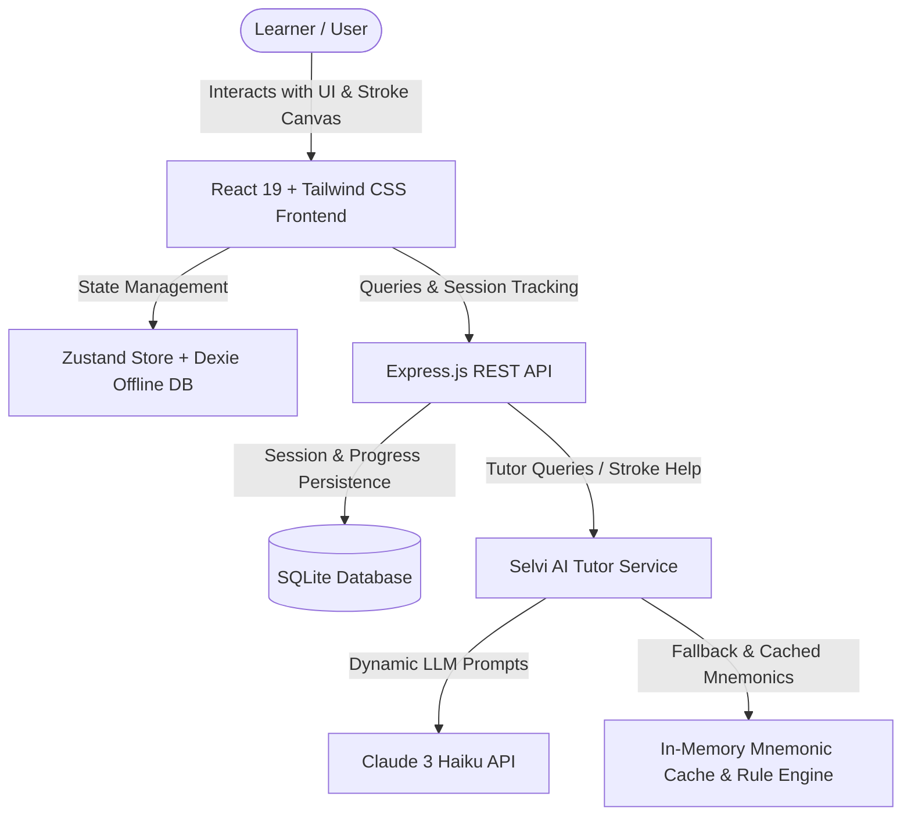

# Tamil LLM — Gamified Tamil Language Learning Platform (PWA) 🌟

[](https://react.dev/)
[](https://nodejs.org/)
[](https://expressjs.com/)
[](https://www.sqlite.org/)
[](https://anthropic.com)
[](https://tailwindcss.com/)
[](LICENSE)

> **Tamil LLM** is an interactive, progressive web application (PWA) designed to take learners from Tamil script fundamentals to conversational fluency through gamified micro-lessons, an interactive Canvas stroke-tracing engine, and **"Selvi"** — an intelligent Claude-powered multilingual AI tutor.

---

## 🌟 Key Highlights

- **12-Month Script-to-Fluency Curriculum**: Structured progression through *Uyir Ezhuthukkal* (vowels), *Mei Ezhuthukkal* (consonants), *Uyirmei*, and conversational phrases with Romanized Tanglish aids.
- **"Selvi" AI Tutor (Claude API + Intelligent Rule Fallback)**: Real-time stroke feedback, pronunciation coaching (e.g. distinguishing the 3 Tamil 'L's: `ழ`, `ள`, `ல`), and contextual mnemonics.
- **Canvas Stroke-Tracing Engine**: Interactive gesture tracking on HTML5 canvas with real-time visual path comparison, stroke-order enforcement, and celebratory animations.
- **Duolingo-Style Gamification**: XP rewards, streak retention counters, milestone badges, and skill trees.
- **Offline-Ready & Persistent**: Lightweight SQLite relational storage for user progress, placement tests, and analytics.

---

## 🏗️ System Architecture



---

## 🚀 Features Breakdown

### 1. "Selvi" — Claude-Powered AI Tutor
- Context-aware explanations adapted to the user's attempt frequency.
- Built-in mnemonic library for tricky Tamil letters (`ழ`, `ண`, `ற`).
- Hybrid execution model: leverages Claude 3 Haiku when online with configured API key, with an instant offline heuristic rule-engine fallback.

### 2. Stroke-Tracing & Canvas Practice Engine
- Real-time stroke path capture with vector smoothing.
- Audio pronunciation clips paired with minimal-pair drills.
- Instant scoring with adaptive hints if a user struggles on specific curves.

### 3. Gamification & Progression
- Daily streak tracker to build consistent learning habits.
- Interactive level selector and customizable learner onboarding (heritage speakers, travelers, beginners).
- Parent & Educator progress dashboard for tracking milestones.

---

## 📂 Project Structure

```
Tamil LLM/
├── public/                 # Static assets, sound effects, PWA icons
├── server/
│   ├── database.sqlite     # SQLite database instance
│   ├── index.js            # Express server & API endpoints
│   ├── package.json        # Server-side dependencies
│   └── tutorService.js     # Selvi AI Claude service & rule engine
├── src/
│   ├── assets/             # Brand logos & graphics
│   ├── components/
│   │   ├── tutor/          # AITutorBubble & AITutorModal
│   │   ├── ui/             # Reusable UI primitives
│   │   ├── AudioRecorder   # Voice recording & playback
│   │   ├── MinimalPairs    # Auditory discrimination exercises
│   │   └── WordGrid        # Letter & vocabulary grid
│   ├── data/
│   │   └── scriptData.js   # 12-month curriculum & character metadata
│   ├── pages/
│   │   ├── Home.jsx        # Dashboard & skill tree overview
│   │   ├── Lesson.jsx      # Stroke tracing & interactive drills
│   │   └── Onboarding.jsx  # Level assessment & goal setting
│   ├── store/
│   │   └── useStore.js     # Zustand state store
│   ├── App.jsx             # App layout & routing
│   └── main.jsx            # Application entrypoint
├── package.json
└── vite.config.js
```

---

## 🛠️ Quick Start

### Prerequisites
- Node.js (v18.0 or newer)
- npm or yarn

### 1. Clone the repository
```bash
git clone https://github.com/Dk043131/tamil-llm.git
cd tamil-llm
```

### 2. Install dependencies
```bash
# Install frontend dependencies
npm install

# Install server dependencies
cd server && npm install && cd ..
```

### 3. Set up environment variables (Optional)
Create a `.env` file in `server/` to enable Claude API tutor features:
```env
PORT=3001
ANTHROPIC_API_KEY=your_claude_api_key_here
```
*(If no API key is provided, Selvi seamlessly operates using the built-in offline linguistic heuristic engine).*

### 4. Run the application
Run both frontend and backend concurrently:
```bash
npm start
```
- Frontend: `http://localhost:5173`
- Backend API: `http://localhost:3001`

---

## 📄 License
This project is open-source under the [MIT License](LICENSE).
